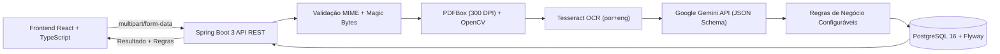

# ValidaDoc — Sistema Inteligente de Validação de Comprovantes de Residência

Aplicação Full Stack para recepção, tratamento de imagem, extração óptica de caracteres (OCR), interpretação semântica com Inteligência Artificial e validação determinística de comprovantes de residência brasileiros.

---

## 1. Visão Geral e Arquitetura

O sistema recebe imagens (`PNG`, `JPG/JPEG`) ou documentos `PDF` (até `10 MB`), executa um pipeline auditável em sete etapas e classifica cada envio em **APROVADO**, **REPROVADO** ou **PENDENTE DE ANÁLISE**. A decisão final pertence exclusivamente ao motor de regras de negócio em Java (Spring Boot), nunca diretamente à IA.



### Etapas do Processamento
1. **Upload e Segurança**: Validação de extensão (`.pdf`, `.png`, `.jpg`, `.jpeg`), MIME type, assinatura binária (*magic bytes*) e tamanho máximo (`10 MB`), com armazenamento isolado fora de diretórios públicos.
2. **Pré-processamento com OpenCV e PDFBox**: Conversão de páginas PDF em `300 DPI` (`Apache PDFBox`) e pipeline nativo `OpenCV` (redimensionamento inteligente, escala de cinza, redução de ruídos Gaussiana, equalização adaptativa de contraste `CLAHE`, correção automática de inclinação *deskew* e binarização de Otsu).
3. **Extração com Tesseract OCR**: Reconhecimento óptico de caracteres em português e inglês via `Tess4J` / `Tesseract 5`.
4. **Interpretação Estruturada com Google Gemini**: Envio do texto extraído à Interactions API (`POST /v1/interactions`, modelo padrão `gemini-4-hydrogen`) com JSON Schema estrito (`nomeTitular`, `cpf`, `endereco`, `cidade`, `estado`, `cep`, `dataEmissao`, `tipoDocumento`), retornando `null` para campos ausentes sem inventar informações. Caso `GEMINI_API_KEY` não esteja configurada, uma abstração determinística de contingência processa o texto OCR sem forjar dados.
5. **Motor de Regras de Negócio (Java 21)**: Avaliação modular e configurável de legibilidade, correspondência de titularidade, consistência de CPF, identificação de endereço/localidade e validade da data de emissão (padrão: até `90 dias`).
6. **Persistência PostgreSQL**: Gravação transacional dos metadados, texto OCR, JSON extraído, status e histórico individual de cada regra avaliada, versionada com **Flyway**.
7. **Apresentação Visual**: Exibição no React com indicadores consolidados, badges semânticos, prévia mascarada (LGPD) e detalhamento das regras aplicadas.

---

## 2. Estrutura de Pastas

```text
Validation/
├── .env.example
├── .gitignore
├── docker-compose.yml
├── README.md
├── backend/
│   ├── Dockerfile
│   ├── pom.xml
│   └── src/
│       ├── main/java/com/cesar/validation/
│       │   ├── config/          # SecurityConfig, OpenApiConfig, AppProperties
│       │   ├── controller/      # DocumentController, DashboardController
│       │   ├── dto/             # Records de entrada e saída da API REST
│       │   ├── entity/          # DocumentSubmission, DocumentRuleResult
│       │   ├── enums/           # DocumentType, ProcessingStatus, ValidationStatus, RuleOutcome
│       │   ├── exception/       # GlobalExceptionHandler e exceções de domínio
│       │   ├── repository/      # DocumentSubmissionRepository
│       │   ├── service/
│       │   │   ├── ai/          # DocumentAiInterpreter, GeminiDocumentInterpreter, HeuristicDocumentExtractor
│       │   │   ├── document/    # DocumentService, DocumentStorageService, DashboardService
│       │   │   ├── image/       # ImagePreprocessingService, OpenCvImagePreprocessingService, PdfPageRendererService
│       │   │   ├── ocr/         # OcrExtractionService, TesseractOcrService
│       │   │   └── validation/  # ResidenceValidationService e regras independentes
│       │   └── util/            # PiiMaskingUtil (LGPD), TextNormalizationUtil
│       ├── main/resources/
│       │   ├── application.yml
│       │   └── db/migration/    # Migrations SQL do Flyway (V1 e V2)
│       └── test/                # Testes unitários e de integração JUnit 5 / MockMvc
└── frontend/
    ├── Dockerfile
    ├── nginx.conf
    ├── package.json
    └── src/
        ├── components/          # Sidebar, Header, FileUploadZone, ProcessStepper, StatCard, DocumentTable, Modal
        ├── hooks/               # useDocumentModal
        ├── layouts/             # MainLayout
        ├── pages/               # Dashboard, Upload, Meus Envios, Resultados, Ajuda
        ├── routes/              # AppRoutes
        ├── services/            # Cliente centralizado Axios (api.ts)
        ├── styles/              # variables.css (paleta obrigatória), global.css, components.css
        ├── test/                # Suíte Vitest + Testing Library
        ├── types/               # Contratos TypeScript
        └── utils/               # Formatadores, máscaras LGPD e validações
```

---

## 3. Tecnologias Principais

- **Frontend**: React 18, TypeScript 5, Vite 5, React Router 6, Axios, Lucide Icons, CSS3 Custom Properties, Vitest + Testing Library, Nginx 1.27.
- **Backend**: Java 21 LTS, Spring Boot 3.3.5 (Web, Data JPA, Validation, Security, Actuator), Flyway, PostgreSQL Driver, SpringDoc OpenAPI (Swagger UI), OpenCV (`org.openpnp:opencv 4.9.0`), Tesseract OCR (`Tess4J 5.13.0`), Apache PDFBox `3.0.3`.
- **Banco de Dados & Infraestrutura**: PostgreSQL 16 Alpine, Docker e Docker Compose com healthchecks e volumes dedicados.

---

## 4. Configuração do Google Gemini e Variáveis de Ambiente

1. Copie o template de configuração na raiz do repositório:
   ```bash
   cp .env.example .env
   ```
2. Gere uma chave de API no [Google AI Studio](https://aistudio.google.com/apikey) e preencha no arquivo `.env` (que é ignorado pelo Git):
   ```env
   GEMINI_API_KEY=sua_chave_aqui
   GEMINI_MODEL=gemini-4-hydrogen
   ```
3. Parâmetros opcionais de regras de negócio também podem ser ajustados no `.env`:
   - `VALIDATION_MAX_DOCUMENT_AGE_DAYS=90` (janela máxima de validade em dias)
   - `VALIDATION_MIN_OCR_CHARS=25` (mínimo de caracteres úteis para legibilidade)
   - `VALIDATION_NAME_SIMILARITY_THRESHOLD=0.60` (similaridade mínima entre titular informado e extraído)

> **Nota**: Caso `GEMINI_API_KEY` seja deixada em branco, o backend utiliza automaticamente a abstração `HeuristicDocumentExtractor` sobre o texto real do Tesseract OCR e registra a origem do processamento, permitindo testar todo o fluxo local sem bloqueios.

---

## 5. Como Executar com Docker

Não é necessário instalar Java, Maven, Node.js ou PostgreSQL na máquina host — apenas o **Docker** com **Docker Compose**.

### Iniciar toda a aplicação
```bash
docker compose up --build
```
*(Ou em segundo plano com `docker compose up -d --build`)*

### Acessos após inicialização
- **Aplicação Web (Frontend React)**: `http://localhost:3000`
- **API REST (Backend Spring Boot)**: `http://localhost:8080/api`
- **Documentação Interativa Swagger / OpenAPI**: `http://localhost:8080/swagger-ui.html`
- **Healthcheck do Backend**: `http://localhost:8080/actuator/health`

### Encerrar o ambiente
```bash
# Parar e remover os containers mantendo os dados persistidos no PostgreSQL:
docker compose down

# Parar e remover containers + volumes de banco e uploads:
docker compose down -v
```

---

## 6. Endpoints da API REST

| Método | Endpoint | Descrição |
| :--- | :--- | :--- |
| `POST` | `/api/documents` | Recebe comprovante (`multipart/form-data`: `file`, `documentType`, `holderName`, `cpf` opcional) e executa todo o pipeline. |
| `GET` | `/api/documents` | Lista comprovantes enviados (suporta filtro opcional `?status=APROVADO\|REPROVADO\|PENDENTE_ANALISE`). |
| `GET` | `/api/documents/{id}` | Retorna metadados e resultado detalhado de um comprovante. |
| `GET` | `/api/documents/{id}/result` | Retorna os campos extraídos, regras avaliadas e parecer final. |
| `GET` | `/api/dashboard` | Retorna indicadores consolidados (total, aprovados, reprovados, pendentes e últimos 5 envios). |
| `DELETE` | `/api/documents/{id}` | Remove o registro do banco de dados e apaga o arquivo físico armazenado. |

---

## 7. Como Executar os Testes Automatizados

A suíte automatizada utiliza mocks para serviços externos pagos e dados sintéticos fictícios, não consumindo cota da API do Gemini.

### Testes do Backend (via Docker + Maven Java 21)
```bash
docker run --rm -v validation-m2-cache:/root/.m2 -v "$(pwd)/backend:/workspace" -w /workspace maven:3.9-eclipse-temurin-21 mvn test -B
```
*(Caso possua JDK 21 e Maven instalados localmente: `cd backend && mvn test`)*

### Testes do Frontend (Vitest + Testing Library)
```bash
cd frontend
npm install
npm test
```

---

## 8. Segurança e Boas Práticas LGPD

- **Mascaramento de Dados Pessoais**: CPFs são mascarados (`000.***.***-00`) nas respostas da API e nas prévias de texto OCR; nenhum CPF ou endereço completo é gravado nos logs da aplicação.
- **Armazenamento Isolado**: Arquivos enviados não ficam expostos em URLs estáticas públicas e passam por verificação de assinatura binária (*magic bytes*) além de MIME e extensão.
- **Direito de Exclusão**: O endpoint `DELETE /api/documents/{id}` remove tanto os registros relacionais (`ON DELETE CASCADE`) quanto o arquivo físico correspondente.
